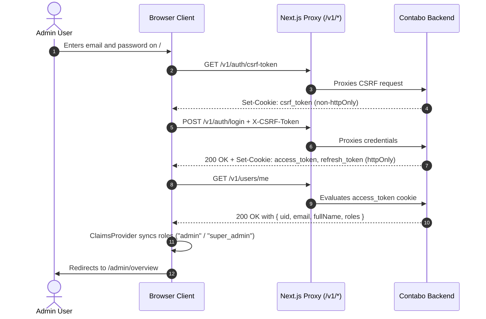
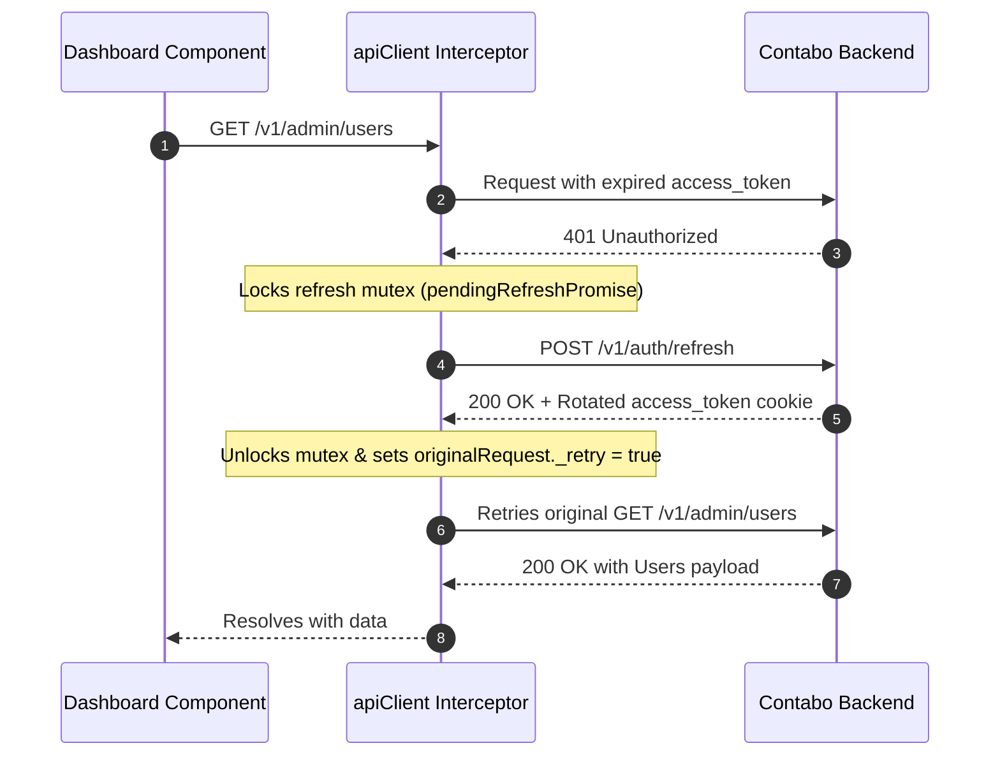
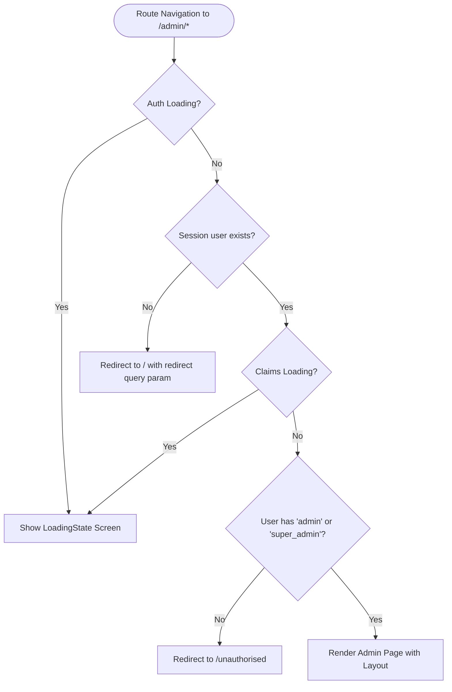

# Application User Flows & State Machines

This document outlines the user flows, security lifecycles, and route guarding logic implemented in the **AlphaDrafts Admin App**.

---

## 1. Authentication & Session Lifecycle

The admin application uses secure **`httpOnly` cookie-based JWT sessions** with double-submit CSRF protection.

---

## 2. Token Expiry & Silent Refresh (401 Mutex)

To maintain seamless administrative sessions without token rotation stampedes, `apiClient` manages a singleton refresh promise:

---

## 3. Role-Based Route Guarding Flow (`useAuthGuard`)

Every page inside `/pages/admin/*` is wrapped in `AdminLayout`, which invokes `useAuthGuard(["admin", "super_admin"])`.

---

## 4. Key Functional Feature Flows

### 4.1 Overview Metrics
1. Admin visits `/admin/overview`.
2. Initial render checks cache: if absent, displays full-screen `LoadingState`.
3. Calls `GET /v1/admin/metrics`.
4. Renders responsive KPI cards for Users, Active Subscriptions (Starter, Student, Professional), Revenue, Projects, and Analyzer runs.
5. Clicking any linked card navigates to `/admin/users` or `/admin/subscriptions`.
6. Subsequent background refreshes execute silently without disrupting the UI.

### 4.2 User Management (`/admin/users`)
1. Fetches paginated user data from `GET /v1/admin/users?skip={skip}&take=50&sort={sort}`.
2. Supports switching sort field between `created_at` and `updated_at`.
3. Displays avatar, name, email, subscription tier, and join date.
4. Action menu allows one-click `mailto:{email}` generation to contact the user directly.
5. Pagination controls recalculate total pages dynamically and smooth-scroll back to table top on page change.

### 4.3 Project Monitoring (`/admin/projects`)
1. Fetches project reports from `GET /v1/admin/projects?skip={skip}&take=50&status={status}`.
2. Filter dropdown enables sorting by status (`All`, `draft`, `in_progress`, `completed`, `archived`).
3. Handles projects with `null` status gracefully via default `"No status"` fallback.
4. Renders creation dates formatted to US local time.

### 4.4 Subscriptions & Revenue (`/admin/subscriptions`)
1. Fetches data from `GET /v1/admin/subscriptions?skip={skip}&take=50&name={name}&status={status}&order=desc`.
2. Normalizes amount values into standard USD currency strings using `formatPrices(cents, "USD")`.
3. Multi-filtering enabled for Plan Tiers (`Starter`, `Student`, `Professional`) and Lifecycle Statuses (`active`, `inactive`, `failed`).

### 4.5 Security Settings & Password Update (`/admin/settings`)
1. Displays authenticated admin's profile details (`displayName`, `email`, avatar).
2. Provides password update form with client-side regex validation (uppercase, lowercase, number, special character, 6–20 characters).
3. Submits `PATCH /v1/users/update-password` with `{ password }`.
4. Displays instant toast notifications on success or specific backend validation failure.

### 4.6 Password Recovery & Email Verification (`/auth/*`)
- **Forgot Password (`/auth/forgot-password`):** Requests `POST /v1/auth/forgot-password` with `{ email }` and presents modal confirmation.
- **Reset Password (`/auth?mode=resetPassword&oobCode=...`):** Validates password pattern and calls `POST /v1/auth/reset-password` with `{ token, password }`.
- **Email Verification (`/auth?mode=verifyEmail&oobCode=...`):** Auto-triggers `POST /v1/auth/verify-email` with `{ token }` on mount and renders visual success/failure states.

