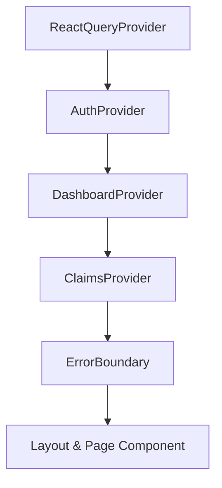

# Architecture Overview

This document details the software architecture, design patterns, and runtime topology of the **AlphaDrafts Admin App**.

---

## 1. High-Level Architecture

The AlphaDrafts Admin Panel is built on **Next.js (Pages Router)** utilizing React 19 and TypeScript. It serves as an administrative control plane communicating with an external backend via a server-side proxy layer.

```
┌─────────────────────────────────────────────────────────────┐
│                    Browser Client (React 19)                │
│                                                             │
│   Pages & Layouts ──► Context Layer ──► TanStack Query v5   │
│                                               │             │
│                                               ▼             │
│                                         Axios apiClient     │
└──────────────────────────────┬──────────────────────────────┘
                               │ withCredentials: true
                               │ X-CSRF-Token header
                               ▼
┌─────────────────────────────────────────────────────────────┐
│                Next.js Host (Proxy & Rewrites)              │
│                                                             │
│    Rewrite Engine: /v1/* ──► ${BACKEND_URL}/v1/*            │
│    (Local Fallback: /v1/* ──► /api/v1/* if BACKEND_URL empty)│
└──────────────────────────────┬──────────────────────────────┘
                               │
                               ▼
┌─────────────────────────────────────────────────────────────┐
│                    Contabo Backend API                      │
│                                                             │
│    Cookie-based JWT Verification (FirebaseAuthGuard/Roles)   │
│    Database Storage (Firestore / Cloud Services)            │
└─────────────────────────────────────────────────────────────┘
```

---

## 2. Key Architectural Tenets

### 2.1 Backend Origin Isolation & Zero Host Hardcoding
- The client application never targets a hardcoded backend hostname directly.
- `constants/auth.ts` exports `API_BASE_URL = ""`.
- All requests use relative URLs (e.g. `/v1/admin/metrics`).
- Next.js handles routing through `next.config.ts` rewrites:
  - When `BACKEND_URL` is set, requests are reverse-proxied to the backend origin.
  - When `BACKEND_URL` is unset, requests route to local Next.js API mock handlers (`/pages/api/v1/*`).

### 2.2 Strict Cookie-Based Identity Model
- Sessions are maintained entirely through `httpOnly`, `SameSite=Lax` cookies (`access_token`, `refresh_token`).
- Tokens are inaccessible to client-side JavaScript, mitigating XSS token theft risks.
- State is hydrated by calling `GET /v1/users/me` on startup.

### 2.3 Double-Submit CSRF Defense
- Safe HTTP methods (`GET`, `HEAD`, `OPTIONS`) do not require CSRF headers.
- Unsafe mutating methods (`POST`, `PUT`, `PATCH`, `DELETE`) require a CSRF token.
- The backend issues a non-httpOnly `csrf_token` cookie via `GET /v1/auth/csrf-token`.
- Axios automatically reads this cookie and injects `X-CSRF-Token` into request headers via request interceptors.

---

## 3. Context Provider Hierarchy

The application wraps all pages in a nested context hierarchy in `context/AppProviders.tsx`:



1. **`ReactQueryProvider`**: Manages server-state caching, invalidation, and background synchronization.
2. **`AuthProvider`**: Fetches `GET /v1/users/me` to determine authenticated user status.
3. **`DashboardProvider`**: Stores active dashboard role flags (`isAdmin`, `isSuperAdmin`, `userRoles`) and manages switching logic.
4. **`ClaimsProvider`**: Derives roles and permissions from the current session user and exposes backward-compatible claims methods.

---

## 4. UI Layer Architecture

- **Pages Router (`pages/`):** Utilizes the `getLayout` pattern (`NextPageWithLayout`) so that layouts (`AdminLayout`, `PublicLayout`) persist across page transitions without unmounting.
- **Tailwind CSS v4:** Modern utility styling with color variables and design tokens (`primary`, `neutral`, `body-medium-14`, etc.).
- **Preline UI Integration:** Accessible UI components (accordions, dropdowns) initialized via `PrelineScriptWrapper` with dynamic client-side imports.
- **Icons:** Standardized on `lucide-react`.

---

## 5. Deployment Topology

The application deploys to **Netlify** using OpenNext (`@netlify/plugin-nextjs`):
- Build configuration defined in `netlify.toml`.
- Node version pinned to 22.
- Environment variables required: `BACKEND_URL` (Server-only).
