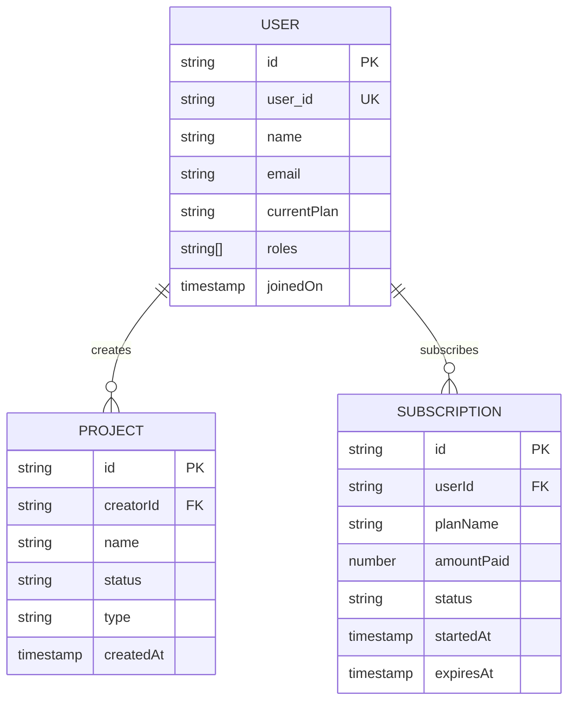

# Database & Entity Schema Documentation

This document describes the data models, entity relationships, and response schemas consumed and managed by the **AlphaDrafts Admin Panel**.

---

## 1. Overview & Data Sources

The admin app interfaces with the **Contabo Backend API** (backed by Firestore / PostgreSQL storage). All API responses are standard-wrapped in a unified response envelope:

```typescript
interface ApiResponse<T> {
  status: "success" | "error";
  message: string;
  data: T;
}

interface PaginationResult<T> {
  data: T[];
  totalCount: number;
  skip: number;
  take: number;
  hasMore: boolean;
}
```

### Timestamp Format
Timestamps from the backend arrive as serialized Firestore timestamps:
```typescript
interface TimestampLike {
  _seconds: number;
  _nanoseconds: number;
}
```
The frontend utility `formatTimestampToDateTwo` parses `TimestampLike`, ISO strings, and standard Date instances.

---

## 2. Entity Schemas

### 2.1 User Entity (`UserReport` / `UserProps`)
Represents registered users in the AlphaDrafts platform.

| Field | Type | Description |
|---|---|---|
| `id` | `string` | Unique identifier (UUID or Firestore document ID) |
| `user_id` | `string` | User reference identifier (matches auth `uid`) |
| `name` | `string` | User's full display name |
| `email` | `string` | Primary email address |
| `phone_number` | `string` | International formatted phone number |
| `avatar` | `string` | Avatar image URL (Unsplash/Firebase storage) |
| `roles` | `("user" \| "admin" \| "super_admin")[]` | Granted platform authorization roles |
| `currentPlan` | `"Starter" \| "Student" \| "Professional"` | Current active subscription tier |
| `subscription` | `{ id: string; name: string }` | Minimal active subscription reference |
| `noOfProjectsCreated` | `number` | Count of projects initiated by the user |
| `accepted_conditions` | `boolean` | Terms of service acceptance flag |
| `joinedOn` | `TimestampLike \| string` | Account registration timestamp |
| `created_at` | `TimestampLike` | Record creation timestamp |
| `updated_at` | `TimestampLike` | Record last update timestamp |

---

### 2.2 Project Entity (`ProjectData` / `ProjectProps`)
Represents academic or professional drafting projects authored by users.

| Field | Type | Description |
|---|---|---|
| `id` | `string` | Unique project identifier |
| `name` | `string` | Project title / headline |
| `creatorName` | `string` | Full name of the project author |
| `creatorId` | `string` | Foreign key referencing `User.user_id` |
| `status` | `string \| null` | `"draft"` \| `"in_progress"` \| `"completed"` \| `"archived"` (fallback handled if null) |
| `type` | `string` | Project category (e.g., `"essay"`, `"research_paper"`, `"thesis"`, `"report"`, `"dissertation"`) |
| `wordCount` | `number` | Estimated or completed word count |
| `createdAt` | `TimestampLike \| string` | Creation timestamp |
| `updatedAt` | `TimestampLike \| string` | Last modified timestamp |

---

### 2.3 Subscription Entity (`Subscription`)
Represents recurring customer billing and tier access.

| Field | Type | Description |
|---|---|---|
| `id` | `string` | Subscription identifier |
| `userId` | `string` | Foreign key referencing `User.user_id` |
| `userName` | `string` | Subscriber full name |
| `userEmail` | `string` | Subscriber contact email |
| `planName` | `"Starter" \| "Student" \| "Professional"` | Plan tier name |
| `amountPaid` | `number \| string` | Normalized price in cents (converted via `formatPrices`) |
| `currency` | `"USD" \| "NGN"` | Billing currency (default `USD`) |
| `status` | `"active" \| "inactive" \| "failed"` | Subscription lifecycle state |
| `startedAt` | `TimestampLike \| string` | Subscription activation timestamp |
| `expiresAt` | `TimestampLike \| string` | Current billing period expiration timestamp |

---

### 2.4 Overview Metrics (`OverviewMetric` / `PlatformStatisticsProps`)
Aggregated KPIs rendered on the executive dashboard (`/admin/overview`).

| Metric Field | Type | Business Meaning |
|---|---|---|
| `noOfUsers` | `number` | Total registered platform users |
| `noOfActiveStarterSubscriptions` | `number` | Active subscriptions on the Starter plan |
| `noOfActiveStudentSubscriptions` | `number` | Active subscriptions on the Student plan |
| `noOfActiveProfessionalSubscriptions` | `number` | Active subscriptions on the Professional plan |
| `moneyMadeFromStudentPlan` | `number` | Total revenue in cents generated by Student tier |
| `moneyMadeFromProfessionalPlan` | `number` | Total revenue in cents generated by Professional tier |
| `noOfProjectsCreated` | `number` | Cumulative projects generated on platform |
| `noOfProjectsCompleted` | `number` | Cumulative projects finalized |
| `noOfInstructionAnalyserRan` | `number` | Cumulative executions of the instruction analyzer tool |

---

### 2.5 Admin Session Identity (`SessionUser`)
Payload returned by `GET /v1/users/me` for authenticated administrative sessions.

| Field | Type | Description |
|---|---|---|
| `uid` | `string` | Administrator unique ID |
| `email` | `string` | Admin email address |
| `fullName` | `string` | Admin name |
| `roles` | `string[]` | Assigned roles (`["admin"]`, `["super_admin"]`, etc.) |
| `emailVerified` | `boolean` | Verification status of administrator email |

---

## 3. Entity Relationship Diagram



